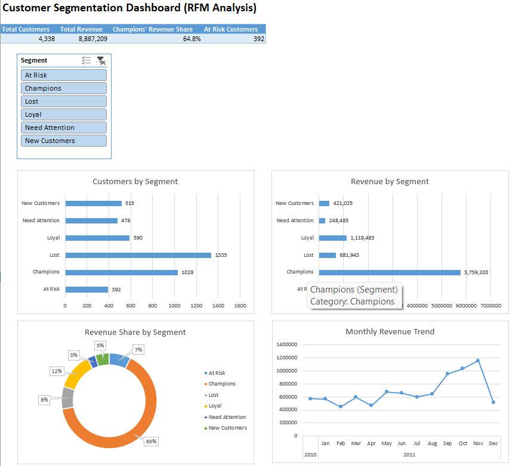

# Customer Segmentation & Retention Analysis (RFM) in Excel

> **Champions (24% of customers) generate 65% of revenue. The 392 At Risk customers are a high-value win-back target, averaging about 3x the lifetime spend of Lost customers.**

## Problem Statement
An online retailer needs to know which customers drive revenue, which are slipping away, and where to focus retention effort. This project segments customers using RFM (Recency, Frequency, Monetary) analysis entirely in Excel.

## Dataset
- **Source:** UCI Machine Learning Repository, "Online Retail" (CC BY 4.0)
- **Size:** 541,909 transactions
- **Period:** 01 Dec 2010 to 09 Dec 2011
- **Business:** UK-based online gift retailer, many customers are wholesalers

## Tools Used
Excel, Power Query, PivotTables, PivotCharts, Slicers, Formulas (IFS, SUMIFS, COUNTIFS, PERCENTILE.INC)

## Dashboard

## Approach
1. **Data cleaning (Power Query):** removed rows with missing CustomerID, cancelled orders (InvoiceNo starting with "C"), zero or negative quantity and price, and duplicate rows. Added a Revenue column (Quantity x UnitPrice).
2. **RFM metrics:** for each customer, Recency = days since last purchase (reference date 10 Dec 2011), Frequency = number of unique orders, Monetary = total revenue.
3. **Scoring:** each metric scored from 1 to 5 using quintiles (PERCENTILE.INC). Recency is reversed so that a recent buyer scores 5.
4. **Segmentation:** customers labelled Champions, Loyal, New Customers, At Risk, Lost, or Need Attention using their Recency and Frequency scores.
5. **Dashboard:** KPI cards, a segment slicer, and charts for customers, revenue, revenue share, and monthly trend.

## Segment Rules

| Segment | Rule |
|---|---|
| Champions | R >= 4 and F >= 4 |
| Loyal | R >= 3 and F >= 3 |
| New Customers | R >= 4 and F <= 2 |
| At Risk | R <= 2 and F >= 3 |
| Lost | R <= 2 and F <= 2 |
| Need Attention | Everything else |

## Key Findings

| Segment | Customers | Avg Orders | Revenue | % of Revenue |
|---|---|---|---|---|
| Champions | 1,028 | 10.7 | 5,759,203 | 64.8% |
| Loyal | 590 | 4.5 | 1,119,483 | 12.6% |
| Lost | 1,335 | 1.3 | 681,943 | 7.7% |
| At Risk | 392 | 4.4 | 657,070 | 7.4% |
| New Customers | 515 | 1.5 | 421,025 | 4.7% |
| Need Attention | 478 | 1.4 | 248,485 | 2.8% |
| **Total** | **4,338** | **4.3** | **8,887,209** | **100%** |

- **A small group drives most of the revenue.** Champions are 24% of customers but bring 64.8% of revenue. Champions and Loyal together (37% of customers) bring about 77%.
- **Lost is the largest group but the least valuable.** 1,335 customers (31%) contribute only 7.7% of revenue.
- **At Risk is the best win-back opportunity.** These 392 customers averaged 4.4 orders each but have been inactive for about 136 days. Each has spent roughly 3x more than a Lost customer.

- **Seasonal peak:** monthly revenue peaks in November 2011 (about 1.16M), consistent with pre-holiday gift buying. December 2011 appears lower only because the data ends on 9 Dec.

## Recommendations
- **Champions:** loyalty rewards and early access to new products to protect the main revenue source.
- **At Risk:** targeted win-back offers first, since they have the highest recovery value.
- **New Customers:** follow-up offers to encourage a second purchase.
- **Lost:** low-cost email campaigns only, as the return per customer is small.

## Limitations
- Many customers have only 1 or 2 orders, so Frequency score groups are not perfectly equal in size.
- December 2011 is incomplete (the data ends on 9 Dec), so it appears lower in the monthly trend chart.
- The analysis is a snapshot based on one year of data from a single retailer.

## Files
- `RFM-analysis.xlsx`: full workbook (cleaned data, RFM table, thresholds, dashboard)
- `data/`: raw dataset
- `screenshots/`: dashboard images

## Author
Vemana Naveen Kumar | [LinkedIn](https://www.linkedin.com/in/vemananaveenkumar) | [GitHub](https://github.com/naveen-kumar-9515)
